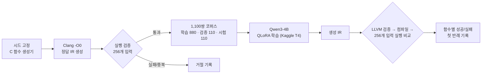

# MAGICompile — C를 LLVM IR로 번역하는 LLM 만들기

작은 C 함수를 LLVM IR로 직접 번역하도록 LLM을 미세조정하고, 생성된 IR이 원본 C와 **같은 값을 계산하는지 실행으로 검증**한 프로젝트입니다. 시드를 고정한 생성기로 만든 uint32 C 함수와 Clang `-O0` IR 1,100쌍(모두 256개 입력에서 실행 검증)으로 Qwen3-4B-Instruct-2507을 QLoRA 학습했습니다. 구조 단위로 분리해 학습·모델 선택에 쓰지 않은 시험 110함수에서 **LLVM 검증·컴파일은 98.2%(108/110)** 통과했지만, **256개 입력 모두에서 원본과 같은 값을 낸 함수는 65.5%(72/110)**였습니다. 실패 38개 중 36개는 문법적으로 유효한 IR이었고, 그중 19개는 Clang이 컴파일 시점에 미리 계산하는 상수를 틀린 경우였습니다. 형식상 올바른 출력이 실제로 올바른 출력을 보장하지 않으며, 이 간극은 실행 기반 평가로만 드러납니다.

| 최종 모델 | 학습 데이터 | 동결 시험 세트 결과 (110함수) |
|---|---|---|
| Qwen3-4B-Instruct-2507 + QLoRA | 실행 검증을 통과한 C–IR 1,100쌍 | LLVM 검증·컴파일 **108/110 (98.2%)**<br>256개 입력 전부 실행 일치 **72/110 (65.5%)** |

---

## 목차

1. [문제 정의 — 왜 이 실험을 했나](#1-문제-정의--왜-이-실험을-했나)
2. [접근 — 검증 가능한 데이터와 평가 파이프라인](#2-접근--검증-가능한-데이터와-평가-파이프라인)
3. [실험 과정 — 모델 선택까지](#3-실험-과정--모델-선택까지)
4. [결과 — 동결 시험 세트](#4-결과--동결-시험-세트)
5. [왜 98.2%와 65.5%가 다른가 — 실패 38개 분석](#5-왜-982와-655가-다른가--실패-38개-분석)
6. [배운 점과 다음 단계](#6-배운-점과-다음-단계)
7. [저장소 구조](#7-저장소-구조)
8. [빠르게 실행해 보기](#8-빠르게-실행해-보기)
9. [범위와 한계](#9-범위와-한계)

---

## 1. 문제 정의 — 왜 이 실험을 했나

LLM이 코드를 "그럴듯하게" 생성하는 것과 **정확한 의미를 보존**하는 것은 다른 문제입니다. 컴파일러 출력(LLVM IR)은 문법이 엄격하고, 정답 여부를 실행으로 객관적으로 확인할 수 있어서 이 차이를 측정하기 좋은 과제입니다.

이 프로젝트가 답하려는 질문:

- 작은 LLM이 C 함수 → LLVM IR 변환을 학습할 수 있는가?
- 생성된 IR이 **LLVM 검증을 통과하는 것**과 **올바른 값을 계산하는 것** 사이에는 얼마나 차이가 있는가?
- 어떤 종류의 코드에서 가장 많이 틀리는가?

대상은 의도적으로 좁게 잡았습니다. 모든 함수는 다음 형식의 부호 없는 32비트 정수 함수입니다.

```c
unsigned int compute(unsigned int x, unsigned int y) {
    unsigned int acc = (x * y);
    acc = (acc + (acc - y));
    return acc;
}
```

모델 입력은 C 소스, 출력은 Clang `-O0`이 만드는 것과 같은 형태의 **전체 LLVM IR 모듈**(타깃 `arm64-apple-macosx`)입니다.

## 2. 접근 — 검증 가능한 데이터와 평가 파이프라인



**데이터 생성** ([`c-llvm-dataset`](c-llvm-dataset/README.md))

- Python 생성기가 고정 시드로 C 함수를 만들고, Clang이 정답 IR을 생성합니다. 외부 Python 패키지 없이 동작합니다.
- 모든 샘플은 경계값 64개 + 고정 시드 난수 192개, **총 256개 입력**에서 다음 세 실행이 Python 기준값과 일치해야 데이터에 포함됩니다.
  1. C를 `-O0`로 컴파일한 실행 파일
  2. 저장한 IR을 다시 읽어 컴파일한 실행 파일
  3. C를 UBSan(미정의 동작 검사기)으로 컴파일한 실행 파일
- 분기의 양쪽 경로, 반복 0·1·16회가 입력에 포함되는지 확인하고, 부족하면 해당 경로를 지나는 입력을 시드 고정 탐색으로 추가합니다.
- 같은 환경에서 다시 생성하면 바이트 단위로 같은 데이터가 나오는지 확인했습니다 ([`reproducibility.json`](c-llvm-dataset/reproducibility.json)).

| 분류 | 내용 | 쌍 수 |
|---|---|---:|
| arithmetic | 덧셈·뺄셈·곱셈 | 220 |
| bitwise | AND·OR·XOR·상수 시프트 | 220 |
| branch | 조건 분기 | 220 |
| loop | 0~16회 반복 | 220 |
| combined | 반복문 안/뒤의 분기 | 220 |
| **합계** | | **1,100** |

### 데이터 분할과 누수 방지

무작위 생성 데이터에는 상수와 변수 이름만 다른 "사실상 같은 함수"가 섞이기 쉽습니다. 샘플 단위로 무작위 분할하면 시험 함수의 구조를 학습 중에 이미 본 셈이 되므로, 다음과 같이 분리하고 확인했습니다.

| 장치 | 방법 | 확인 결과 |
|---|---|---|
| 분할 단위 | 개별 샘플이 아니라 **구조 해시(`structure_id`)** 단위로 분할. 상수·변수 이름만 다른 변형은 항상 같은 분할에 들어감 | 분할 간 구조 해시 겹침 **0** |
| 결정적 배정 | 분류별로 `sha256(seed:category:structure_id)` 순으로 정렬해 마지막 10%는 시험, 그 앞 10%는 검증, 나머지는 학습. 분류마다 176 / 22 / 22로 균등 | [`split_report.json`](c-llvm-dataset/corpus-1100-v001/split_report.json) |
| 중복 검사 | 1,100쌍 전체에서 ID·C 소스·IR·구조 해시 충돌 검사 | 충돌 **0** ([`duplicates.json`](c-llvm-dataset/corpus-1100-v001/duplicates.json)) |
| 분할 간 교차 검사 | 학습·검증·시험 사이의 C 소스 해시, IR 해시 겹침 검사 | C **0** / IR **0** |
| 이전 분할 보존 | 파일럿 실험의 시험 10개가 새 학습·검증 분할에 섞이지 않도록 기존 분할 유지 | 섞인 것 **0** |
| 시험 세트 동결 | 학습, loss 측정, 체크포인트·모델 선택에 시험 세트를 쓰지 않음. 모델 선택은 검증 분할에서 뽑은 probe 20함수로만 수행하고, 평가기는 probe에 시험 ID가 있으면 실행 전에 거부. 시험 추론 입력에는 정답 IR·기대값을 넣지 않음 | 최종 모델 고정 후 **1회만** 평가 |

**남은 한계:** 구조 해시는 상수·이름만 다른 변형을 묶습니다. 같은 생성 문법에서 나온 "모양이 비슷한" 구조는 다른 분할에 있을 수 있어서, 이번 결과는 같은 분포 안(IID)의 일반화입니다. 더 거친 구조 family 단위의 OOD 평가는 [다음 학습 계획](c-llvm-dataset/docs/plans/NEXT_TRAINING_PROPOSAL.md)에 넣었습니다. 시험 오답을 분석했기 때문에 이 시험 세트는 이제 노출된 것으로 보고, 개선한 모델은 새 시험 세트로 평가합니다.

**평가 원칙**

- 모델 출력은 **원문 그대로** 평가합니다. 코드 블록 제거, 자동 수리, 타깃 변경을 하지 않습니다.
- 실패(생성 중단·문법 오류 포함)도 분모에서 빼지 않습니다.
- "성공"은 256개 입력 **전부**에서 원본 C와 결과가 같은 경우만 셉니다.

## 3. 실험 과정 — 모델 선택까지

| 단계 | 무엇을 했나 | 결과 | 기록 |
|---|---|---|---|
| ① 환경 확인 | 직접 만든 27M 파라미터 Transformer를 Kaggle T4에서 20 step 학습, 체크포인트 저장·재개 | 학습 파이프라인 동작 확인 | [01 환경 확인](c-llvm-dataset/docs/experiments/01_KAGGLE_SMOKE.md) |
| ② 처음부터 학습 | 같은 모델을 파일럿 100쌍으로 200 step 학습 | 검증 loss 6.92 → **0.898**, 하지만 생성 IR은 형식부터 깨짐 | [02 처음부터 학습](c-llvm-dataset/docs/experiments/02_SCRATCH_TRAINING.md) |
| ③ 사전학습 모델 비교 | Qwen2.5-Coder-1.5B를 QLoRA로 60 step 학습해 ②와 비교 (검증 10함수) | 직접 만든 모델 0/10, Qwen 학습 전 0/10, **Qwen QLoRA 2/10** | [03 Qwen2.5 비교](c-llvm-dataset/docs/experiments/03_QWEN25_COMPARISON.md) |
| ④ 데이터 확장 + 주력 모델 교체 | 데이터를 1,100쌍으로 늘리고 Qwen3-4B-Instruct-2507로 220 step(1 epoch) QLoRA | 검증 probe 20함수 중 **14/20** 실행 일치 | [04 Qwen3 학습](c-llvm-dataset/docs/experiments/04_QWEN3_TRAINING.md) |
| ⑤ 동결 시험 | 학습에 한 번도 쓰지 않은 시험 110함수로 최종 평가 (greedy) | **72/110 (65.5%)** | [05 동결 시험](c-llvm-dataset/docs/experiments/05_QWEN3_TEST.md) |
| ⑥ 로컬 실행 | adapter를 병합해 Ollama 모델 `magicompile-qwen3:4b`로 등록, 로컬 비교 CLI 제작 | 로컬에서 C → IR → 실행 비교 가능 | [Ollama 등록](c-llvm-dataset/docs/guides/OLLAMA_LOCAL.md), [LocalTestPipeline](LocalTestPipeline/README.md) |

### 모델 비교 (③ 단계, 같은 검증 함수 10개)

| 모델 | 생성 완료 | LLVM 검증 | 컴파일 | 모든 입력 일치 |
|---|---:|---:|---:|---:|
| 직접 만든 모델 (27M, 처음부터 학습) | 10/10 | 0/10 | 0/10 | 0/10 |
| Qwen2.5-Coder-1.5B, 학습 전 | 7/10 | 0/10 | 0/10 | 0/10 |
| Qwen2.5-Coder-1.5B, QLoRA 60 step | 8/10 | 4/10 | 4/10 | 2/10 |
| Qwen3-4B, QLoRA 220 step (④, 참고) | — | — | — | 7/10 |

> 낮은 loss가 곧 정확도는 아니었습니다. 처음부터 학습한 모델은 loss가 크게 줄었지만 유효한 IR을 하나도 만들지 못했고, 이 결과로 사전학습 모델 미세조정으로 방향을 바꿨습니다. ④의 7/10은 데이터·모델 크기·학습량이 모두 달라 순수한 모델 효과는 아닙니다.

## 4. 결과 — 동결 시험 세트

Qwen3-4B adapter를 고정한 뒤 시험 110함수를 한 번만 평가했습니다. (greedy 1회 생성, 최대 4,096토큰 / 600초, 재시도 없음)

**단계별 통과율**

| 평가 단계 | 통과 | 비율 |
|---|---:|---:|
| EOS까지 생성 완료 | 110 / 110 | 100.0% |
| LLVM 구조 검증 | 108 / 110 | 98.2% |
| 지원 범위 검사 + 컴파일 | 108 / 110 | 98.2% |
| **256개 입력 모두 실행 일치** | **72 / 110** | **65.5%** |

**분류별 실행 일치율**

| 분류 | LLVM 검증 | 실행 일치 | 성공률 |
|---|---:|---:|---:|
| branch | 22 / 22 | 17 / 22 | 77.3% |
| arithmetic | 22 / 22 | 16 / 22 | 72.7% |
| bitwise | 21 / 22 | 16 / 22 | 72.7% |
| loop | 21 / 22 | 15 / 22 | 68.2% |
| combined | 22 / 22 | **8 / 22** | **36.4%** |

함수별 결과는 [`report.json`](c-llvm-dataset/training/evaluations/qwen3-test-002/report.json)과 [`analysis.json`](c-llvm-dataset/training/evaluations/qwen3-test-002/analysis.json)에 있습니다.

<details>
<summary>학습 지표와 자원 사용량</summary>

| 항목 | 값 |
|---|---|
| 기반 모델 | `Qwen/Qwen3-4B-Instruct-2507` (리비전 고정: [`qwen3-model-lock.json`](c-llvm-dataset/training/qwen3-model-lock.json)) |
| 방식 | NF4 4비트 QLoRA, rank 8 / alpha 16, all-linear, 학습 파라미터 16,515,072개 |
| 학습량 | 220 step = 학습 880쌍 1 epoch, 배치 1 × 누적 4, LR 1e-4 |
| 검증 loss | 0.752 (학습 전) → 0.00845 (55 step) → **0.00445** (220 step) |
| 학습 시간 / GPU 메모리 | 약 2시간 17분 / 최대 11.3GiB (Kaggle T4 1개) |
| 시험 추론 | T4 2개 병렬, 약 3시간 20분, 함수당 평균 212초 |

</details>

## 5. 왜 98.2%와 65.5%가 다른가 — 실패 38개 분석

**LLVM 검증이 보는 것과 보지 않는 것.** LLVM verifier는 타입이 맞는지, SSA 값이 정의된 뒤에 쓰이는지, 기본 블록이 올바르게 끝나는지 같은 *형식*을 검사합니다. `or i32 %x, 219`를 `or i32 %x, 15`로 바꾸거나 `add`를 `xor`로 바꿔도 IR은 여전히 유효합니다. 검증·컴파일 통과는 필요조건일 뿐이고, 의미가 맞는지는 실행해 봐야 알 수 있습니다. 시험에서 이 차이(32.7%p)가 정확히 **컴파일은 되지만 값이 틀린 36개 함수**입니다.

### 실패 유형 × 분류

| 분류 | 실패 | LLVM 검증 실패 | 컴파일 OK, **상수만** 틀림 | 컴파일 OK, **명령·데이터 흐름**이 틀림 |
|---|---:|---:|---:|---:|
| arithmetic | 6 | 0 | 3 | 3 |
| bitwise | 6 | 1 | 3 | 2 |
| branch | 5 | 0 | 5 | 0 |
| loop | 7 | 1 | 5 | 1 |
| combined | 14 | 0 | 0 | **14** |
| **합계** | **38** | **2** | **16** | **20** |

"상수만 틀림"은 주석을 뺀 함수 본문에서 SSA 이름과 명령 구조는 그대로 두고 숫자 리터럴만 가려 비교했을 때 정답과 같은 경우입니다. 휴리스틱 분류이며, 한 함수에 여러 오류가 함께 있을 수 있습니다. LLVM 검증 실패 2개는 정의하지 않은 `%i.addr` 사용(`loop-017`)과, PHI가 아닌 `and` 명령이 자기 결과를 참조한 경우(`ext001-bitwise-178`)입니다.

### 의미가 깨지는 세 지점

**① 컴파일러가 미리 계산하는 상수 — 실행 오답 36개 중 19개.** Clang은 `-O0`에서도 `3682684371u >> 24u` 같은 상수식을 컴파일 시점에 계산하고, IR에는 결과값 `219`만 남깁니다. 모델은 C 소스에 없는 이 값을 스스로 32비트 연산으로 계산해야 합니다. 실행 오답 36개 중 19개에서는 틀리거나 빠진 정답 상수가 C 소스에 그대로 적혀 있지 않은 값, 즉 계산을 거쳐야 나오는 값이었습니다.

| 함수 | C 소스의 상수식 | 정답 IR | 모델이 생성한 IR |
|---|---|---|---|
| `bitwise-007` | `3682684371u >> 24u` (= 219) | `or i32 %xor, 219` | `or i32 %xor, 15` |
| `combined-003` | `106641914u >> 26u` (= 1) | `or i32 1, %xor14` | `or i32 0, %xor14` |
| `ext001-combined-153` | `15u \| 3u` (= 15) | `xor i32 %33, 15` | `xor i32 %33, 18` — OR 대신 더함 |

**② 연산 종류와 상수 표현의 혼동.** `ext001-loop-174`의 `4294967295u + acc`는 IR에서 `add i32 -1, ...`가 됩니다(4294967295 = -1). 모델은 같은 상수를 쓰는 비트 반전 관용구인 `xor i32 -1, ...`를 생성했습니다. 같은 상수가 서로 다른 연산과 짝지어지는 패턴을 혼동한 것으로 보입니다.

**③ 긴 제어 흐름에서의 데이터 흐름 손실.** combined 오답 14개는 **모두 LLVM 검증과 컴파일을 통과**했지만 명령 구조가 정답과 달랐습니다. 반복문 안 분기와 반복문 뒤 분기가 이어지는 긴 함수에서 명령 누락, 피연산자 교체, 상수 오류가 함께 나타납니다. 다른 분류에서도 같은 유형이 보입니다. 예를 들어 `ext001-bitwise-190`은 누적값과 XOR하는 명령을 빠뜨렸습니다.

### "거의 맞는" 오답이 많다

실행 오답 36개 가운데 **14개는 256개 입력 중 절반 이상에서 정답과 같은 값**을 냈고, 2개는 200개 이상(최대 217/256, `ext001-branch-047`)에서 맞았습니다. 반대로 6개는 하나도 맞지 않았습니다. 틀린 상수 하나는 특정 비트 패턴이나 분기 경로에서만 결과를 바꾸기 때문에, 입력 몇 개로 확인하면 틀린 IR을 맞다고 판단하기 쉽습니다. 경계값 조합과 분기·반복 경로를 덮는 입력 세트가 필요한 이유입니다.

**근거 자료:** 실패 38개의 정답/생성 diff [`teacher-diffs/`](c-llvm-dataset/training/evaluations/qwen3-test-002/teacher-diffs), 함수별 첫 반례와 일치 입력 수 [`analysis.json`](c-llvm-dataset/training/evaluations/qwen3-test-002/analysis.json), 유형·분류·상수 분석 [`failure-breakdown.json`](c-llvm-dataset/training/evaluations/qwen3-test-002/failure-breakdown.json). 마지막 파일은 [`analyze_failure_constants.py`](c-llvm-dataset/training/analyze_failure_constants.py)로 다시 만들 수 있습니다.

## 6. 배운 점과 다음 단계

**배운 점**

1. **형식상 올바름 ≠ 실제로 올바름.** 컴파일 성공 98.2%와 실행 일치 65.5% 사이의 32.7%p는 모두 "유효하지만 틀린" IR입니다.
2. **번역에 숨은 계산이 가장 약하다.** 실행 오답의 절반 이상(19/36)이 Clang이 미리 계산하는 상수와 관련됐습니다. 모델은 토큰을 옮기는 일보다 32비트 연산을 정확히 수행하는 일에서 더 많이 틀립니다.
3. **loss는 정확도의 대리 지표가 아니다.** 검증 토큰 loss 0.0044에서도 상수 하나가 바뀌면 함수 전체가 틀립니다.
4. **실행 기반 평가는 입력 설계가 중요하다.** 오답 14개는 입력의 절반 이상에서 맞는 값을 냈습니다. 단계별 기록(생성 → 검증 → 컴파일 → 실행)과 경로를 덮는 입력이 있어야 실패를 찾고 원인을 나눌 수 있습니다.
5. **복합 제어 흐름이 가장 취약하다.** 반복문과 분기가 섞인 combined가 36.4%로 가장 낮고, 오답 14개 모두 컴파일은 통과했습니다.

**다음 단계** (제안 단계이며 아직 학습은 시작하지 않음)

- 고정 타깃 속성(`target-cpu`, `target-features`)을 모델 출력에서 분리해 프로그램이 붙이기 — 실제로 모델이 존재하지 않는 `+sha` 속성을 만드는 문제가 있었습니다.
- 상수식 계산(시프트·OR·곱셈 결과)과 combined 구조를 중심으로 데이터 2,000쌍 추가
- 구조 family 단위의 미노출 평가 추가, 실행 일치율로 checkpoint 선택
- 이번 시험 세트는 오답을 분석했으므로, 개선 모델은 **새로운 미노출 시험 세트**로 평가

자세한 내용: [다음 학습 개선 제안서](c-llvm-dataset/docs/plans/NEXT_TRAINING_PROPOSAL.md) · [준비안 v003](c-llvm-dataset/docs/plans/NEXT_TRAINING_PREPARATION.md) · [코드 생성 명세](c-llvm-dataset/docs/plans/NEXT_TRAINING_CODEGEN_SPEC.md)

## 7. 저장소 구조

```text
.
├── c-llvm-dataset/                 # 데이터 생성·검증, 학습, 평가
│   ├── run_pipeline.py             #   데이터 생성/검증 CLI (doctor·generate·validate·compare)
│   ├── src/c_llvm_dataset/         #   생성기, Clang 래퍼, 구조 중복 제거, 코퍼스 병합
│   ├── artifacts/                  #   파일럿 100쌍 (샘플별 C·IR·AST·입력·검증 결과)
│   ├── artifacts-ext001/           #   확장 1,000쌍
│   ├── corpus-1100-v001/           #   학습에 사용한 통합 코퍼스 + 학습/검증/시험 분할
│   ├── training/                   #   Kaggle 학습·추론 스크립트, 평가기, 결과
│   │   ├── evaluations/            #     생성 IR의 함수별 평가 결과 (qwen3-test-002 = 최종 시험)
│   │   ├── kaggle-results/         #     원격 학습/추론 출력과 지표
│   │   └── proposals/              #     다음 학습 계획 근거 자료
│   ├── local/ollama/               #   adapter 병합 → Ollama 등록 도구
│   ├── docs/                       #   문서 (목차: docs/README.md)
│   │   ├── experiments/            #     단계별 실험 기록 01~05 (3장의 표 참고)
│   │   ├── guides/                 #     데이터 생성 지침, Ollama 등록 방법
│   │   └── plans/                  #     다음 학습 제안서·준비안·코드 생성 명세
│   └── tests/
└── LocalTestPipeline/              # 로컬 Ollama 모델로 C → IR 생성 후 실행 비교하는 CLI
    ├── run.py
    ├── inputs/                     #   예제 C 함수
    └── tests/
```

## 8. 빠르게 실행해 보기

필요 환경: **macOS ARM64**, Python 3.11 이상, Clang. 데이터 도구는 외부 Python 패키지가 필요 없습니다.

**데이터 검증 재현**

```bash
cd c-llvm-dataset
python3 run_pipeline.py doctor                       # 도구와 검증기 동작 확인
python3 run_pipeline.py validate artifacts --execute # 저장된 IR을 다시 검증·실행
python3 -m unittest discover -s tests -v
```

**학습된 모델로 내 C 함수 변환해 보기** (Ollama에 `magicompile-qwen3:4b`가 등록되어 있어야 합니다 — [등록 방법](c-llvm-dataset/docs/guides/OLLAMA_LOCAL.md))

```bash
cd LocalTestPipeline
python3 run.py --file branch_loop.c
```

원본 C와 생성 IR을 각각 컴파일해 256개 입력의 결과를 비교하고, 첫 불일치 입력과 전체 기록을 `outputs/`에 저장합니다. 모델 없이 비교 경로만 확인하려면 `--ir-file`로 기존 IR을 넘기면 됩니다.

## 9. 범위와 한계

- **좁은 범위:** 인자 2개짜리 uint32 함수, 산술·비트·분기·제한된 반복만 다룹니다. 포인터·배열·실수·함수 호출이 있는 일반 C의 성능을 뜻하지 않습니다.
- **유한 입력 검사:** "실행 일치"는 함수당 256개 입력에서의 결과 일치이며, 모든 입력에서의 동등성 증명이 아닙니다.
- **플랫폼:** 데이터와 실행 검증은 macOS ARM64 / Apple Clang 21 기준입니다. Linux 실행 경로는 검증하지 않았습니다.
- **수치 경로 차이:** 시험 65.5%는 Kaggle의 NF4 기반 모델 + adapter에서 측정했습니다. 로컬 Ollama(FP16 병합) 모델에서 같은 정확도가 나온다고 보장하지 않습니다.
- **포함하지 않은 것:** 모델 가중치와 LoRA adapter, 실행 로그는 용량 문제로 저장소에 올리지 않았습니다. 학습·추론은 개인 Kaggle 계정의 비공개 작업으로 실행했으며, 제출 스크립트와 내려받은 지표는 `training/`에 있습니다.

## Credits

- 무작위 C 코드 생성기 작성에 [Claude Sonnet 5.5](https://www.anthropic.com/claude/sonnet)를 사용했습니다.
- 기반 모델: [Qwen/Qwen3-4B-Instruct-2507](https://huggingface.co/Qwen/Qwen3-4B-Instruct-2507)
