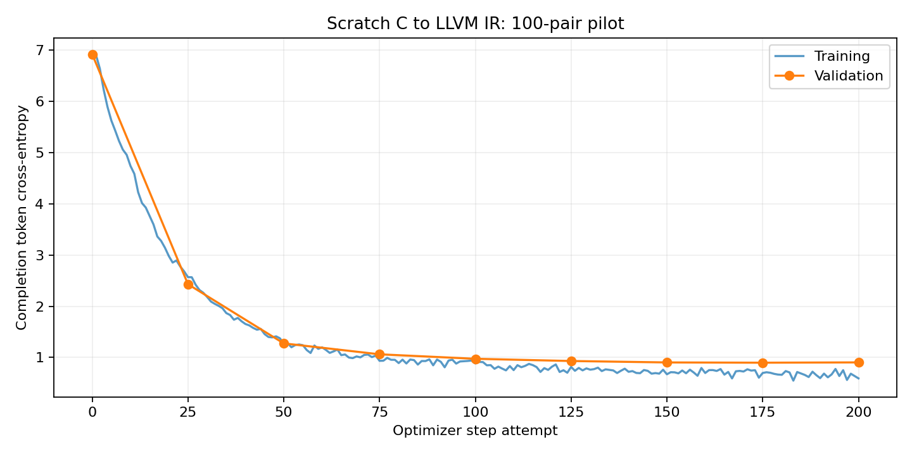

# 첫 200 step 학습 결과

2026년 11월 13일, 기존 파일럿 100쌍으로 토크나이저와 모델을 처음부터 학습했습니다. 비공개 Kaggle 작업은 `COMPLETE`로 종료됐고, 실제 optimizer 업데이트 200회를 확인했습니다.

- [요약 지표](../../training/kaggle-results/pilot-001/scratch-pilot-001/summary.json)
- [전체 학습 지표](../../training/kaggle-results/pilot-001/scratch-pilot-001/metrics.json)
- [생성 미리보기](../../training/kaggle-results/pilot-001/scratch-pilot-001/validation-preview.json)
- [제출 코드](../../training/kaggle-pilot-001/run.py), [설정](../../training/kaggle-pilot-001/kernel-metadata.json)

## 설정과 실제 측정값

| 항목 | 값 |
|---|---|
| 시작 가중치 | 무작위 초기화; 사전학습 가중치 사용 안 함 |
| 모델 | 8층·너비 512·head 8, 27,253,760 파라미터 |
| 토크나이저 | 학습 80개 자료만으로 만든 byte-level BPE, 실제 어휘 900개 |
| 데이터 | 학습 80개·검증 10개·시험 10개 |
| GPU | T4 두 개 할당, `cuda:0` 한 개 사용 |
| 문맥 길이 | 3,072토큰; 정답 잘라내기 없음 |
| 배치 / 누적 | 1개 / 8회 |
| 학습률 | 0.0003, warmup 20 step, cosine decay |
| 정밀도 | fp16 AMP |
| 실제 업데이트 | 200회 |
| 체크포인트 | 50 step마다 및 마지막 저장 |
| 최저 검증 모델 | 검증 loss가 개선될 때마다 별도 저장 |
| 순수 학습 함수 경과 시간 | 약 109.6초; 검증·체크포인트 저장 포함 |
| 스크립트 초기화~요약 경과 시간 | 약 131.5초; 대기·업로드·다운로드 제외 |
| 최대 GPU 메모리 | 약 1.79GiB, 현재 실행에서 측정 |
| 실행 후 GPU 할당량 | 29.95시간 남음 |

이번 실행은 20 step 시험 학습 가중치에서 이어가지 않고, 무작위 초기화부터 새로 시작했습니다. 미니배치는 학습 자료에서 복원 추출했습니다. 시험 10개는 모델 학습, 토크나이저 학습, loss 평가, 생성 미리보기에 사용하지 않았습니다.

## 학습 곡선

| step | 검증 loss |
|---:|---:|
| 0 | 6.92218 |
| 25 | 2.43057 |
| 50 | 1.27537 |
| 75 | 1.06229 |
| 100 | 0.97463 |
| 125 | 0.93129 |
| 150 | 0.90349 |
| 175 | **0.89831** |
| 200 | 0.90437 |

마지막 step의 학습 loss는 0.59227입니다. 최저 검증 loss 모델은 175 step의 `model-best.pt`, 마지막 학습 상태는 200 step의 `checkpoint-latest.pt`입니다. 최저 검증 모델과 마지막 체크포인트의 가중치는 다를 수 있습니다.

## 해석과 한계

학습·검증 토큰 loss가 모두 감소했고, 후반부 검증 loss 개선은 작아졌습니다. 175 step과 200 step 사이의 작은 차이만으로 일반화나 과적합을 확정하지 않습니다.

검증 자료 `arithmetic-017`로 128토큰 생성 미리보기를 수행했습니다. 출력에는 LLVM 모듈 헤더 형태가 나타나지만 함수 선언의 오류와 토큰 반복이 관찰됐고, 종료 토큰 없이 생성 한도에 도달했습니다. 이 출력은 완성된 IR로 취급하지 않습니다.

이번 결과는 처음부터 학습하는 모델이 실제로 업데이트되고, 지표와 가중치를 저장할 수 있다는 첫 학습 결과입니다. LLVM 구문 통과율, 컴파일 성공률, 의미 정확도를 측정한 결과는 아닙니다. 정답의 반복적인 헤더와 명령 형식 학습이 토큰 loss에 영향을 줬을 가능성이 있으며, C 의미를 보존하는 변환 능력은 별도 실행 평가로 확인해야 합니다.

현재 100쌍은 소규모 파일럿입니다. 다음 실험에서는 생성·검증 규칙을 유지하면서 데이터 구조와 수량을 늘리고, 구조 계열을 분리한 평가와 컴파일·실행 평가를 준비하는 것이 적절합니다. [생성 전 지침](../guides/DATASET_GENERATION_GUIDELINES.md)을 함께 확인하세요.

## 산출물 보관

로컬 폴더 `training/kaggle-results/pilot-001/`에 지표·로그·학습 곡선·최저 검증 모델·마지막 재개용 체크포인트를 보관합니다. Kaggle 원격 출력에는 마지막 전체 모델 `model.pt`와 이전 체크포인트도 남아 있습니다.

다운로드 후 `training/verify_first_training.py`로 모델의 strict 로드, 유한한 가중치, 지표와 체크포인트 일치, optimizer 업데이트 수, 최저 검증 모델 선택 근거를 확인합니다. 확인 결과와 파일 SHA-256은 `download-verification.json`에 기록합니다.

로컬 검증을 완료했고 모두 통과했습니다. 실제 optimizer 업데이트는 200회이며 최저 검증 모델은 175 step, 마지막 체크포인트는 200 step입니다. 두 가중치는 서로 다르고, 체크포인트의 지표는 다운로드한 `metrics.json`과 일치합니다. [다운로드 검증 기록](../../training/kaggle-results/pilot-001/download-verification.json)을 참고하세요.

별도 Kaggle 세션에서 이어 학습하려면 체크포인트와 토크나이저를 입력으로 연결해야 합니다. 현재 제출 스크립트를 다시 실행하면 새 세션에서 200 step 학습을 처음부터 시작합니다. 이 실행의 200 step 설정을 넘기는 연장 학습에는 scheduler와 재개 설정을 함께 설계해야 합니다.
